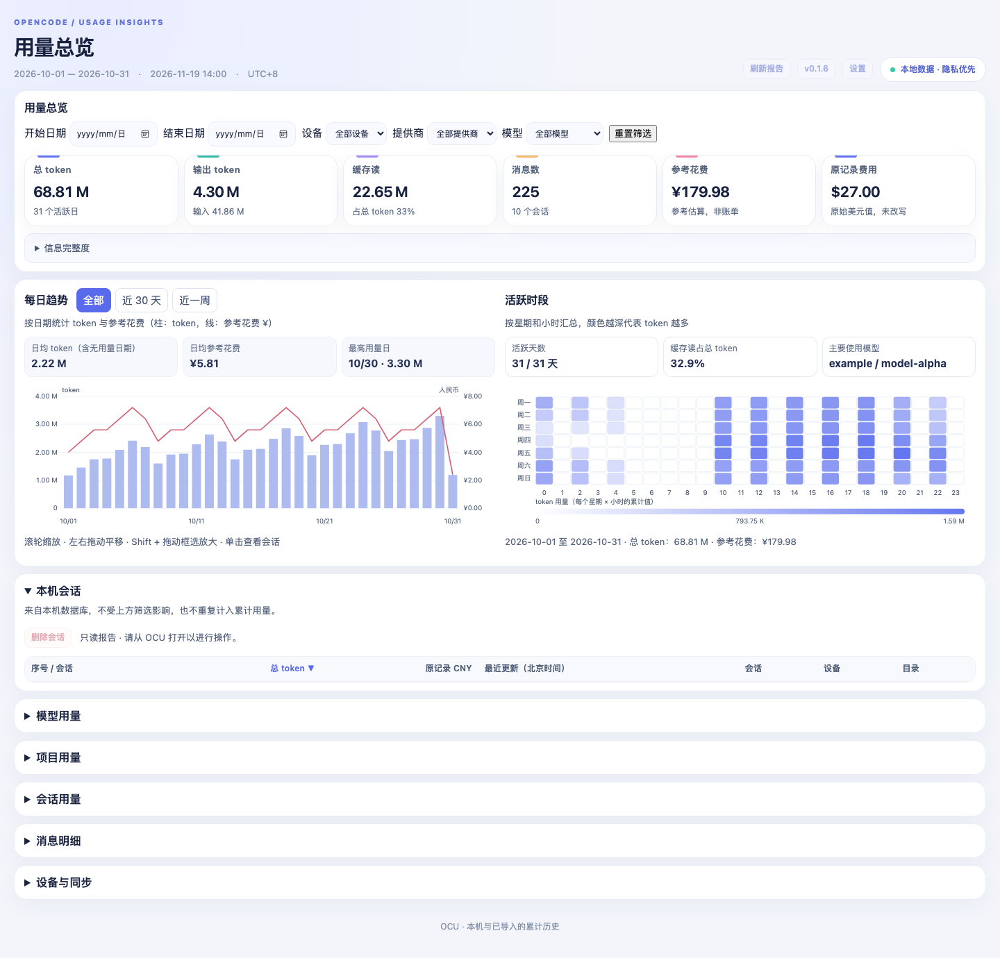

# OpenCode Usage

[](https://github.com/Deal23/opencode-usage/actions/workflows/tests.yml)

轻量的 OpenCode 用量统计与跨设备汇总工具，支持 Windows、macOS 和 Linux，**零第三方运行时依赖**。

- 本地 HTML 看板、Markdown 报告和按需导出的 CSV 明细。
- 多设备快照合并、来源追踪和重复消息去重。
- 自动备份、同步状态与命令行自动化。

当前版本 **0.1.3**

**0.1.3 更新：** 优化看板布局和每日趋势交互，支持日期缩放、平移与会话明细；模型分布按名称聚合并展示供应商明细。参考费用为估算，模型原始标识和台账不因看板分组而改写。

## 看板预览



示例数据展示用量趋势、活跃时段和模型分布。看板还提供项目、会话、设备与同步明细。

模型分布按名称聚合，点击可查看供应商明细。每日趋势支持时间范围选择、缩放和平移，点击日期可查看会话消耗。

## 安装

需要 Python 3.9+。通过 Git 下载源码：

```sh
git clone https://github.com/Deal23/opencode-usage.git
cd opencode-usage
```

或在仓库页面选择 **Code → Download ZIP**，解压后进入源码目录。

运行安装命令：

```sh
python3 install.py       # macOS / Linux
py -3 install.py         # Windows
```

按提示刷新终端后运行 `ocu`。Linux 缺少 venv 时需安装 `python3-venv`。更多信息见[安装、更新与卸载](docs/INSTALLATION.md)。

## 终端面板

首次运行设置设备名称，通过菜单刷新报告、管理数据或调整设置：


选 **1 刷新**更新统计、生成报告并导出累计快照至 `exports/`；CSV 可在 **数据 → 导出 CSV** 中按需导出。完整快照包含会话标题和项目路径，请仅与可信设备共享。

在 **数据 → 模型参考价格** 查看价格和缺价状态。价格文件位于工作目录的 `prices/model-prices.json`，可按页面提供的文档自行或借助 AI 更新。详见[模型价格维护手册](docs/AUTOMATION.md#模型价格维护手册)。

主菜单 **v 可视化报告**打开 HTML；**t 文档报告**在终端显示用量概览，适合 Linux / SSH。报告使用最近一次刷新数据；文档报告支持 `less` 分页（按 `q` 退出）。

在主菜单选择 **3 会话**，可进入、重命名或批量删除 OpenCode 会话。删除前会列出子会话并要求确认；已采集的用量保留，刷新后更新看板。

## 多设备汇总

- **手动：** 各设备刷新后复制 `exports/` 中的快照，在汇总设备导入。
- **自动：** 各设备使用独立工作目录，在 **数据 → 同步** 设置同一个云盘交换目录。OCU 交换快照，云盘负责传输。

## 数据与隐私

- 采集时只读源数据库；累计数据与报告默认保存在 `~/.local/share/ocusage/`。
- 刷新生成的本地快照包含完整信息；自动交换默认不包含标题和项目路径。
- 自动备份保护累计台账，也可备份整个工作目录。

## 文档与开发

- [第一次使用与常见问题](docs/QUICKSTART.md) · [安装与卸载](docs/INSTALLATION.md)
- [数据流、备份与恢复](docs/DATA_FLOW.md) · [自动化与报表设置](docs/AUTOMATION.md)
- [开发手册](docs/DEVELOPMENT.md) · [开发路线](docs/ROADMAP.md) · [MIT License](LICENSE)

```sh
python3 -m pip install -e .
python3 -m unittest discover -s tests -v
```
