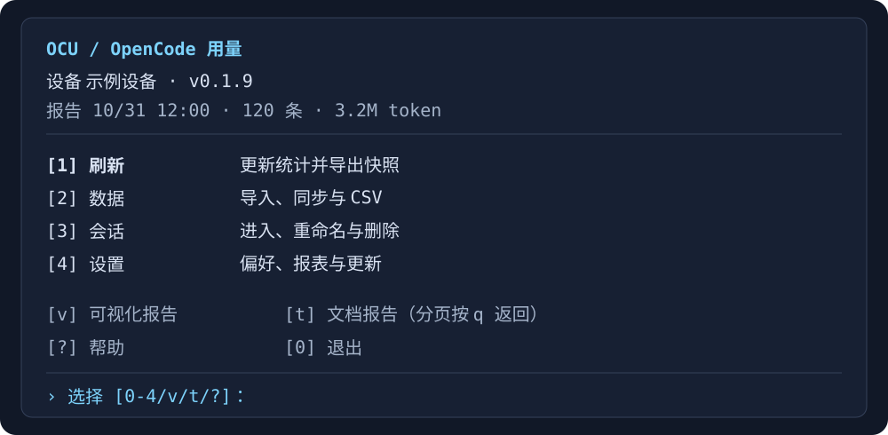

# OpenCode Usage

[](https://github.com/Deal23/opencode-usage/actions/workflows/tests.yml)

轻量的 OpenCode 用量统计与跨设备汇总工具，支持 Windows、macOS 和 Linux，**零第三方运行时依赖**。

- 本地 HTML 看板、Markdown 报告和按需导出的 CSV 明细。
- 多设备快照合并、来源追踪和重复消息去重。
- 自动备份、同步状态与命令行自动化。

当前版本 **0.1.6**

## 看板预览


查看用量趋势、活跃时段，以及模型、项目、会话和设备明细。每日趋势支持缩放、平移和按日期查看会话；点击模型分布可查看供应商明细。

## 安装

需要 Python 3.9+。通过 Git 下载源码：

```sh
git clone https://github.com/Deal23/opencode-usage.git
cd opencode-usage
```

或在仓库页面选择 **Code → Download ZIP**，解压后进入源码目录。

运行安装命令：

```sh
python3 install.py       # macOS / Linux
py -3 install.py         # Windows
```

按提示刷新终端后运行 `ocu`。Linux 缺少 venv 时需安装 `python3-venv`。更多信息见[安装、更新与卸载](docs/INSTALLATION.md)。

## 终端面板

首次运行设置设备名称，通过菜单刷新报告、管理数据或调整设置：



- **1 刷新**：更新统计和报告，并将累计快照导出到 `exports/`。
- **v 可视化报告**：打开网页看板，可筛选用量、管理本机会话及调整设置。交互操作需要保持 OCU 运行；直接打开 HTML 为只读模式。
- **t 文档报告**：在终端查看用量概览，适合 Linux / SSH；使用 `less` 分页时按 `q` 退出。
- **3 会话**：进入、重命名或批量删除 OpenCode 会话。
- **2 数据**：导入快照、导出 CSV、配置同步或维护[模型参考价格](docs/AUTOMATION.md#模型价格维护手册)。

看板顶部可刷新报告；如需交互输入，请返回终端。看板右上角可检查更新或进入设置，更新或迁移后重新运行 OCU。

## 多设备汇总

- **手动：** 各设备刷新后复制 `exports/` 中的快照，在汇总设备导入。
- **自动：** 各设备使用独立工作目录，在 **数据 → 同步** 设置同一个云盘交换目录。OCU 交换快照，云盘负责传输。

## 数据与隐私

- 采集时只读源数据库；累计数据与报告默认保存在 `~/.local/share/ocusage/`。
- 刷新生成的本地快照包含完整信息；自动交换默认不包含标题和项目路径。
- 自动备份保护累计台账，也可备份整个工作目录。

## 文档与开发

- [第一次使用与常见问题](docs/QUICKSTART.md) · [安装与卸载](docs/INSTALLATION.md)
- [数据流、备份与恢复](docs/DATA_FLOW.md) · [自动化与报表设置](docs/AUTOMATION.md)
- [开发手册](docs/DEVELOPMENT.md) · [开发路线](docs/ROADMAP.md) · [MIT License](LICENSE)

```sh
python3 -m pip install -e .
python3 -m unittest discover -s tests -v
```
